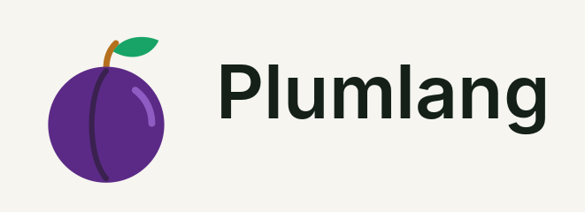

<p align="center">
  
</p>

<p align="center">
  The brand of the Plumlang programming language: marks, colours, type, social cards, and the VS Code extension.<br>
  Plumlang was created by Ayushman Bhattacharya, Subhro Koley and Rohan Hudati. An <a href="https://elixpo.com">Elixpo</a> production.
</p>

<p align="center">
  <a href="docs/brand-system.md">Brand system</a> ·
  <a href="https://plum.elixpo.com">Website</a> ·
  <a href="https://github.com/plumlang/plumlang">Language</a> ·
  <a href="vscode/">VS Code extension</a>
</p>

---

## About

This repository holds everything that makes Plumlang recognisable. Its
identity is a project identity inside Elixpo's
[Open Field](https://github.com/elixpo/elixpo/blob/main/docs/brand-system.md)
system: Elixpo's paper, ink and editorial layout, with the plum as Plumlang's
own mark. The rules are in [docs/brand-system.md](docs/brand-system.md).

Plumlang has two registers. The **Open Field** mark, a flat plum with a seam,
a stem and a leaf, is the default on the website, in documentation and on
social cards. The **pixel** plum is the community register: the org cover,
the editor's file icon, stickers and events.

| Open Field | Pixel |
|---|---|
|  |  |

## Contents

| Folder | Tier | Contents |
|---|---|---|
| [`brand/`](brand/) | Masters | The marks as SVG, the colour and type tokens in [`palette.json`](brand/palette.json), and [`provenance.json`](brand/provenance.json). The only files edited by hand. |
| [`icons/`](icons/) | Derivatives | The mark as PNG from 16 to 512 px, `favicon.ico`, `apple-touch-icon.png`, and the pixel mark at whole multiples. |
| [`social/`](social/) | Derivatives | The avatar and the light and dark lockups. |
| [`og/`](og/) | Derivatives | Social cards for the website (1280×720) and repository previews (1280×640). |
| [`prompts/`](prompts/) | Text | The text and code on each social card. |
| [`pipeline/`](pipeline/) | Tooling | [`build.py`](pipeline/build.py), which renders every derivative. |
| [`references/`](references/) | References | Approved material the masters are judged against. |
| [`vscode/`](vscode/) | Product | The VS Code extension. |
| [`docs/`](docs/) | Rules | The [brand system](docs/brand-system.md). |

## Colours

| | Token | Hex |
|---|---|---|
| Plumlang | Plum | `#5B2A86` |
| | Plum deep | `#3A2150` |
| | Plum night | `#24143A` |
| | Plum light | `#8E5CC2` |
| | Plum mist | `#C9A8EE` |
| | Stem | `#B5701E` |
| Open Field | Paper | `#F6F5F0` |
| | Ink | `#142018` |
| | Field green | `#18A466` |
| | Foundry green | `#0B623C` |
| | Archive warm | `#F0E6D3` |

Roles and contrast ratios are in the
[brand system](docs/brand-system.md#colour).

## Using the assets

| Where | File |
|---|---|
| Website favicon and app icons | `icons/favicon.ico`, `icons/plum-mark-192.png`, `icons/plum-mark-512.png`, `icons/apple-touch-icon.png` |
| Website Open Graph image | `og/plum.elixpo/default.png` (documentation pages: `og/plum.elixpo/docs.png`) |
| GitHub organisation avatar | `social/avatar-512.png` |
| Repository social previews | `og/repos/<repository>.png` |
| README headers | `social/lockup-light.png`, `social/lockup-dark.png` |

Link to the files here, or copy them; the website copies them into its own
`public/` folder.

## Rendering

The derivatives are rendered from the masters, never edited by hand:

```bash
pip install -r requirements.txt
python pipeline/build.py           # render icons, lockups and cards
python pipeline/build.py --check   # verify outputs against brand/provenance.json
```

The renderer needs Cairo and the fonts named in `brand/palette.json`, and
records the font it used for each output. CI runs `--check`, which fails when
a master changed without a new render or an output was edited by hand.

To add a social card, add a Markdown file under `prompts/og/<surface>/`
(see [prompts/og/README.md](prompts/og/README.md)) and render.

## VS Code extension

The extension lives in [`vscode/`](vscode/): syntax highlighting, editor
configuration, and the Plum file icon themes. It is published to the
Marketplace by the `Publish VS Code extension` workflow when the version in
`vscode/package.json` goes up. Build it locally with:

```bash
cd vscode
npm ci
npm run compile
```

The grammar is being updated for the current language, and language-server
features arrive with `plum lsp`
([plumlang#31](https://github.com/plumlang/plumlang/issues/31)).

## Releases

| Asset set | Status |
|---|---|
| Brand system | Draft, under review. |
| VS Code extension | `0.1.x` on the Marketplace. The next release follows `plum lsp`. |

Brand changes are recorded in the history of [`docs/brand-system.md`](docs/brand-system.md)
and [`brand/provenance.json`](brand/provenance.json).

## Repositories

| Repository | Contents |
|---|---|
| [plumlang](https://github.com/plumlang/plumlang) | The language: compiler, virtual machine, standard library, specification. |
| [plum.elixpo](https://github.com/plumlang/plum.elixpo) | The website at plum.elixpo.com: documentation and playground. |
| [branding](https://github.com/plumlang/branding) | The brand and the VS Code extension (this repository). |

## Contributing

Read the [brand system](docs/brand-system.md) first. Change a master in
`brand/` or the text in `prompts/`, render, and open a pull request with both
the master and its derivatives. Questions go to
[Discussions](https://github.com/plumlang/plumlang/discussions) or
**hello@elixpo.com**.

## Trademarks

Plumlang and the Plumlang logo are trademarks of Elixpo. Use of the marks
follows [TRADEMARKS.md](https://github.com/plumlang/plumlang/blob/main/TRADEMARKS.md)
in the language repository. The Material icons in the extension are used
under the licence in
[`vscode/icons/material-icons-LICENSE.txt`](vscode/icons/material-icons-LICENSE.txt).

---

<p align="center"><sub>© 2026 Elixpo. Plumlang and the Plumlang logo are trademarks of Elixpo.</sub></p>
